<div align="center">


# OKOK Libre

**A private, offline Android app for OKOK Bluetooth body composition scales.**

No ads, no account, no cloud. It tells you what your weight is actually doing.

[](https://github.com/JYunth/okok-libre/releases/latest)
[](https://github.com/JYunth/okok-libre/actions/workflows/ci.yml)
[](LICENSE)
[](#install)

<br>

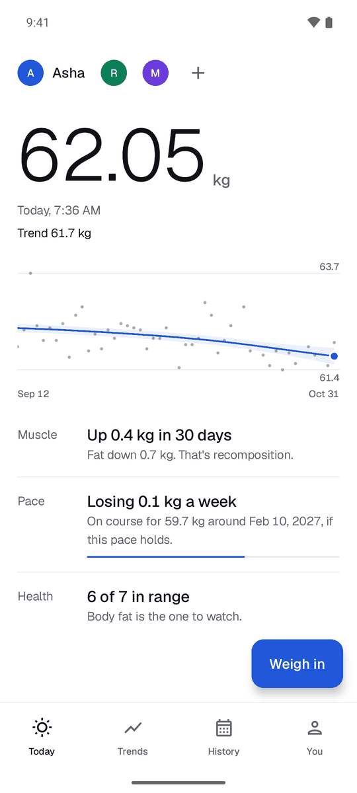
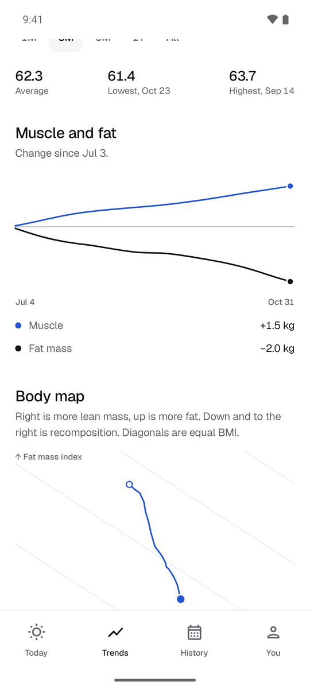
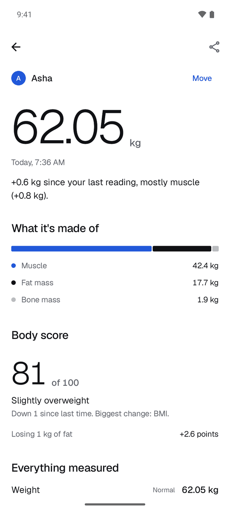
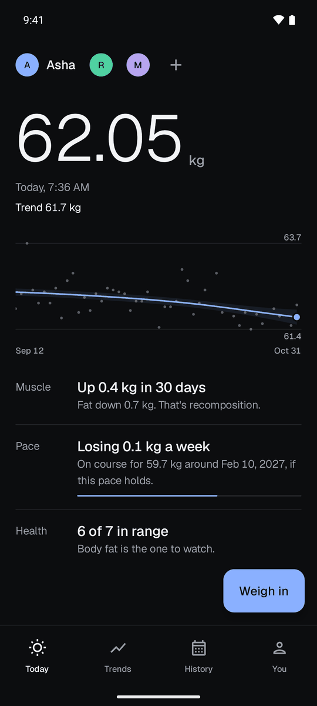

<sub>Screenshots use a made-up demo family, not real people's data.</sub>

</div>

## Why

Smart scales collect useful data, then bury it in apps full of ads and account prompts. OKOK Libre works with the same scale and keeps everything on your phone. The app doesn't even have the internet permission.

It also does more with your readings. Instead of showing a number that jumps around with your water intake, it estimates what your body is really doing, says how sure it is, and stays quiet when the data can't support a claim.

## What it does

**Answers three questions after every weigh-in**

- **Am I gaining muscle?** Muscle and fat change over 30 days, including recomposition when the scale barely moves.
- **Am I on pace?** Your real rate of change, whether it's safe, and a likely date range for your goal.
- **Am I healthy?** Where each number sits against its standard range, and what would raise your score most.

**Filters out the noise**

- A statistical trend model separates real change from daily water swings and copes with skipped days.
- Each reading gets a hydration check against your own baseline, so a dry morning doesn't look like fat gain.
- Readings without body composition data never distort the analysis.

**Goes deeper in Trends**

- 13 metrics, from one month to all time. Drag any chart to read a day.
- A body composition map, phases of losing, holding and gaining, and estimated energy balance.
- Your weekly rhythm and how consistent you've been.

**Made for a household on one phone**

- Everyone's readings, goals and reminders stay separate.
- A weigh-in goes to whoever it fits. If it can't tell, it asks. If it's wrong, move the reading in a tap.
- The whole app takes on the active person's colour, so you always know whose data you're seeing.

**Yours to keep**

- One-file backup and restore, plus spreadsheet export.
- Guest weigh-ins, offline scale history, reading comparison and weigh-in reminders.
- Light and dark themes. Units in kg, lb, st:lb, jin, cm and ft/in.

<div align="center">
<br>
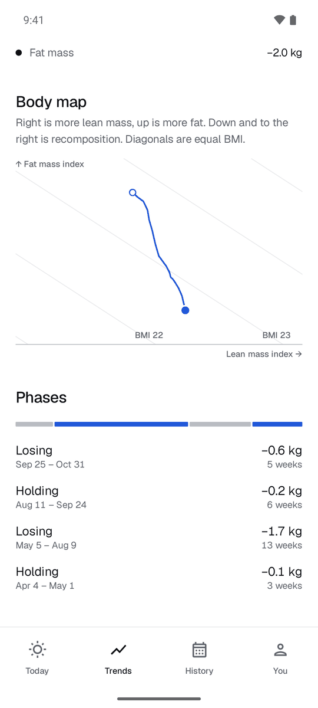
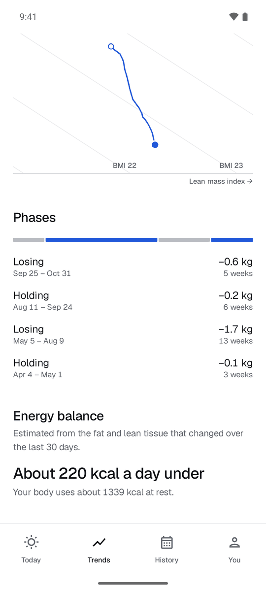
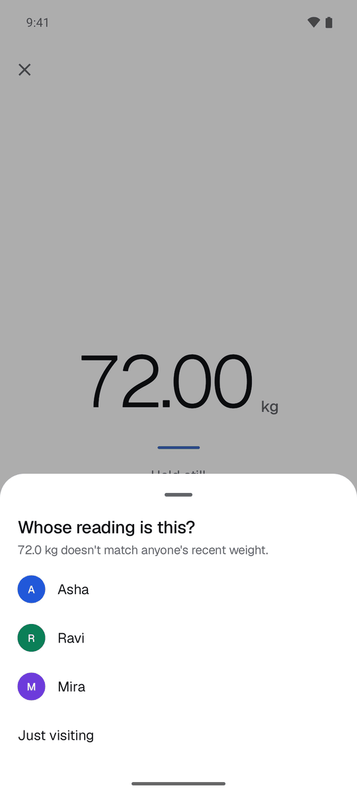
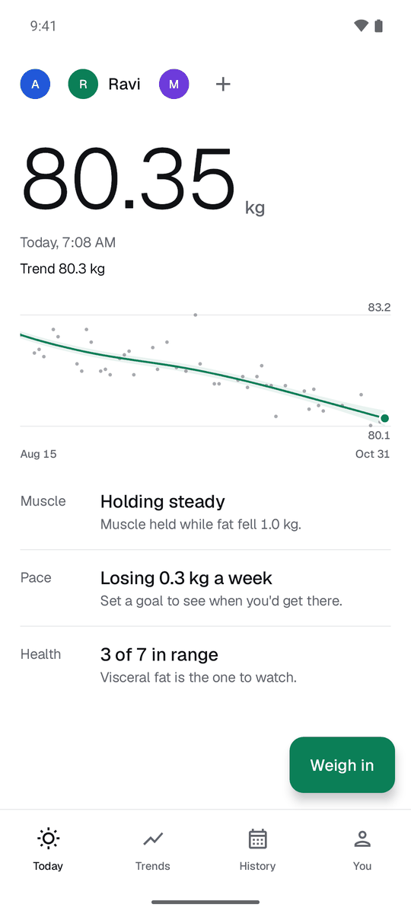
<br><br>
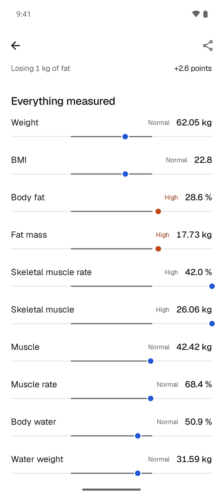
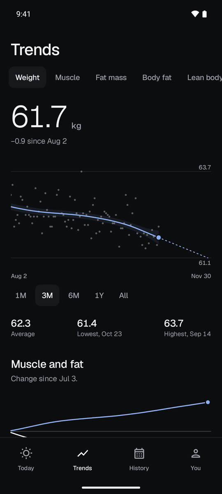
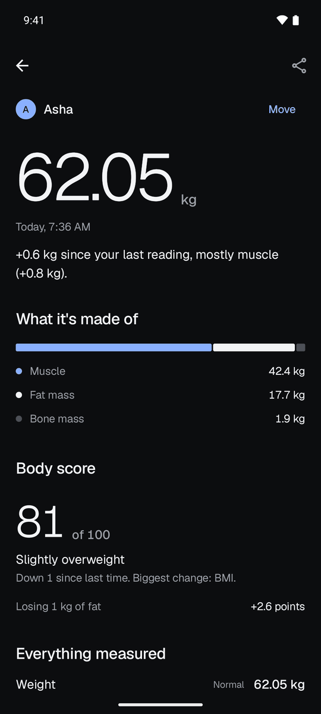
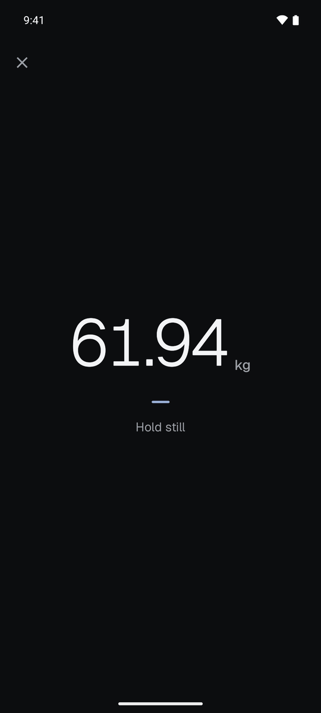
</div>

## Install

1. Download the APK from the [latest release](https://github.com/JYunth/okok-libre/releases/latest).
2. Open it on your phone and allow installing from that source.
3. Follow the setup, then add your scale from the Today screen.

You need Android 8.0 or newer and a phone with Bluetooth LE. Android 12 and newer only ask for Bluetooth access. Android 11 and older also ask for location, because the system won't show Bluetooth scales without it.

## Supported scales

OKOK Libre is built for Bluetooth scales that pair with the OKOK International app, using the classic, OKOKCloud and OKOKCloudV4 protocols. Some other device families that app supports aren't implemented yet.

Scales vary: some measure impedance, some send their own body composition figures, and some only report weight. If yours doesn't work, please [open an issue](https://github.com/JYunth/okok-libre/issues/new/choose) with its model.

## Privacy

- No internet permission, analytics, ads or account.
- Your data stays in the app's private storage, and Android cloud backup is turned off.
- Data leaves your phone only when you export it yourself. Backup files aren't encrypted, so keep them somewhere private.

## Build from source

You need JDK 21 and the Android SDK (platform 36).

```sh
git clone https://github.com/JYunth/okok-libre.git
cd okok-libre/app

./gradlew assembleDebug                 # debug APK
./gradlew testDebugUnitTest             # unit tests
./gradlew connectedDebugAndroidTest     # database and profile tests, needs a device or emulator
```

Release builds use the debug key unless you supply your own. See [`app/keystore.properties.example`](app/keystore.properties.example).

No scale nearby? Debug builds include a demo household and a simulated scale. See [CONTRIBUTING.md](CONTRIBUTING.md#working-without-a-scale).

## Project layout

```
app/app/src/main/java/app/okoklibre
├── ble         Bluetooth scanning, connection and scale protocols
├── algo        body composition, grading and unit conversion
├── data        Room database, active profile, attribution and backups
├── insights    trend model and analysis, all pure Kotlin
├── reminders   weigh-in reminders
└── ui          Jetpack Compose screens and design system
```

[`docs/INSIGHTS.md`](docs/INSIGHTS.md) explains how readings become answers, and [`DESIGN.md`](DESIGN.md) sets out the visual rules.

## Contributing

Bug reports, scale compatibility notes and pull requests are all welcome. Start with [CONTRIBUTING.md](CONTRIBUTING.md). To report a security problem, see [SECURITY.md](SECURITY.md).

## Disclaimer

OKOK Libre is an independent project. It isn't affiliated with, endorsed by or supported by Chipsea, OKOK or any scale manufacturer. All names are used only to describe compatibility, and trademarks belong to their owners.

Body composition figures are estimates from a bathroom scale. They aren't medical advice, and this isn't a medical device.

## License

[GPL-3.0](LICENSE). You're free to use, study, change and share this software. If you distribute a modified version, it must stay open source under the same license.

The app bundles the [Geist](https://github.com/vercel/geist-font) typeface under the SIL Open Font License.
